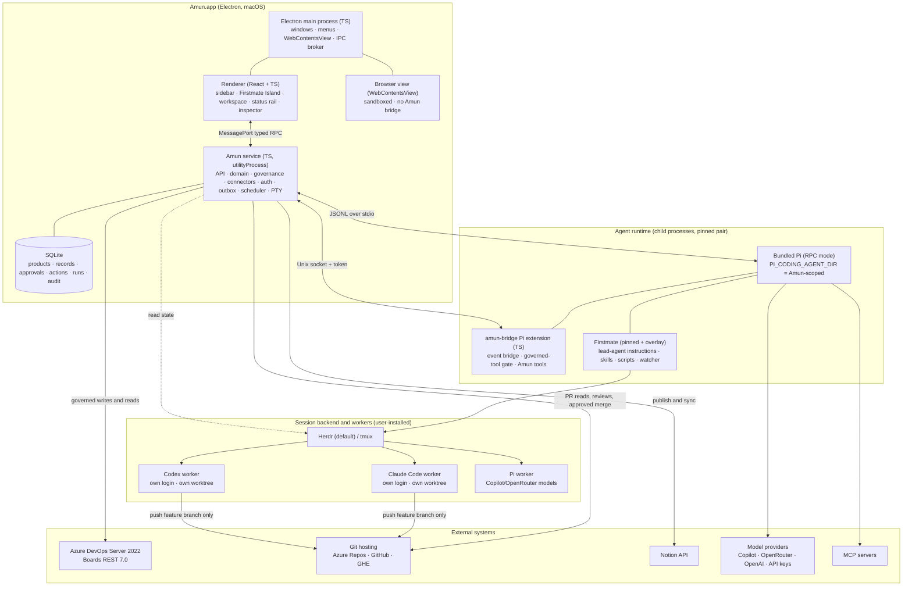
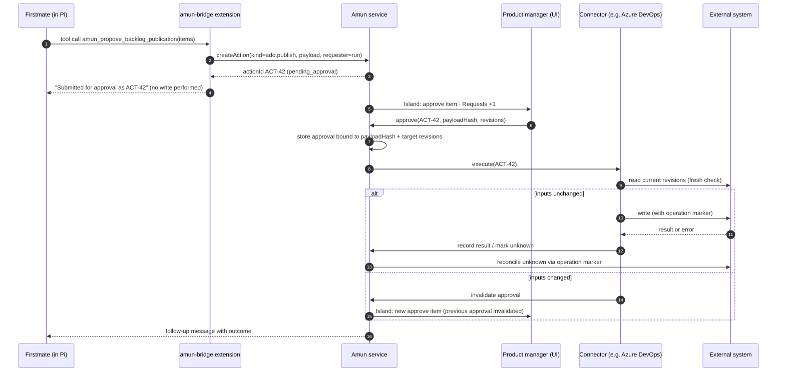
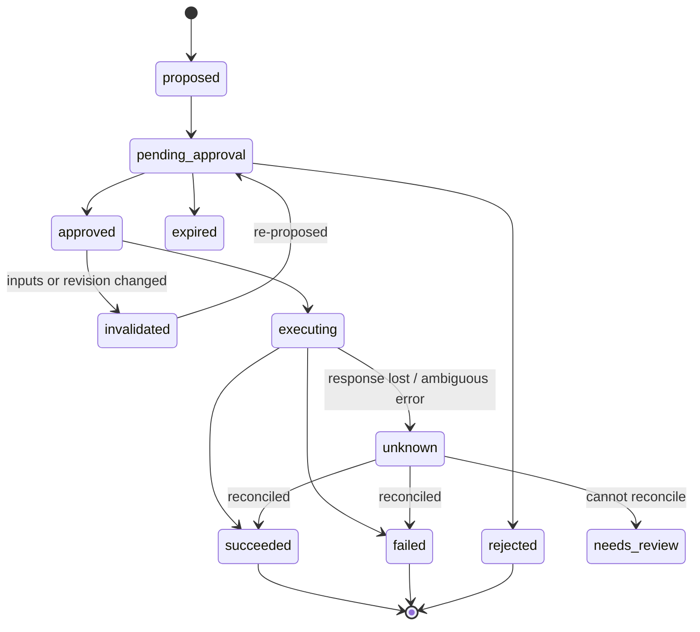
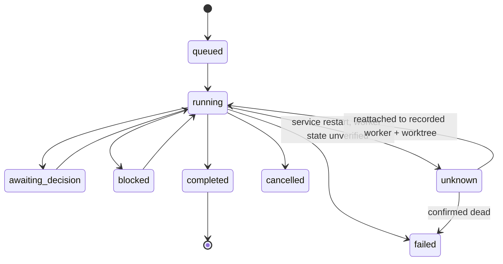
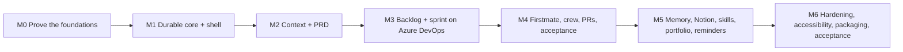

# Amun — Product Vision, Release Plan and R1 Implementation Plan

Version 2.0 · Product owner: Tamer Sabry · Status: approved for R1 implementation planning

---

## 0. How to use this document (instructions for the implementing agent)

1. **Read sections 1–7 for intent, sections 8–13 for how to build, and sections 14–16 for what to build next.** Section 15 is the ordered task list. Build tasks in the listed order unless a task says it can run in parallel.
2. **Never mark a task done without its tests passing and its Definition of Done (DoD) evidence attached** (test output, screenshots, or recorded logs) in `docs/evidence/<task-id>/`.
3. **Never fake an integration.** Mock data may drive UI development, but a connector, runtime, or approval task is only done when it passes against the real system named in its DoD.
4. **Do not invent APIs.** When a library or server behaviour is uncertain, write a spike test that proves it and record the result in `docs/decisions/ADR-xxx.md`.
5. **Do not silently drop scope.** If a required capability cannot be delivered, stop, record the blocker, and raise it as a product-owner decision.
6. **Pin every external dependency** (npm lockfile, Pi version, Firstmate commit). Upgrades are separate tasks with their own regression run.
7. Language rules: **TypeScript (strict) everywhere in Amun-owned code.** Bash only where Firstmate already uses it. No Rust, Swift or Python in Amun-owned code for R1.

---

## 1. Vision

**Enable a person to lead product work from intent through delivery with a coordinated AI crew, persistent context, and clear human decisions.**

### Positioning

Give Amun the objective. Firstmate proposes the path, coordinates the crew, tracks progress, and brings the decisions back to you.

### Product description

Amun is an AI product delivery workspace for people who define, design, coordinate and accept product work. A product manager states an objective. **Firstmate**, Amun's lead agent, clarifies intent, uses product context, coordinates specialist agents, prepares requirements, organises delivery, and returns decisions and results for human approval.

Stories, bugs, tasks, sprints, branches, pull requests, context and decisions stay connected to the objective. Amun shows progress and its evidence in language a non-technical product professional can understand.

### What makes Amun different

| Typical agent workspace (Paseo, OpenChamber, T3 Code, Orca, Yardlet) | Amun |
|---|---|
| Unit of work is a coding session or thread | Unit of work is an **approved objective and its stories** |
| User is a developer supervising agents | User is a **PM / product owner** directing a crew |
| Approvals are tool permission prompts | Approvals are **versioned product decisions** bound to an exact revision |
| Delivery status = agent finished | Delivery status = **evidence**: approved scope → published work → PR → checks → PM acceptance |
| Integrations are generic MCP tools | **Governed connectors** for Azure DevOps Server, GitHub and Notion with recovery and no duplicates |

### Product principles

1. **The PM never needs a terminal** for the core journey. Terminal and browser exist for inspection.
2. **Every consequential external action has a separate, explicit approval** (publish backlog ≠ commit sprint ≠ merge PR).
3. **The component that performs a write is the component that enforces its approval.**
4. **Unknown is a valid state.** Never show an uncertain result as success.
5. **The interface is calm.** Fixed navigation positions; one dynamic area (the Firstmate Island); no surprise pop-ups.
6. **Reuse before build.** Pi provides models and the agent runtime. Firstmate provides crew orchestration. Amun builds the product layer.
7. **Fewer choices, faster decisions (Hick's Law).** Decision time grows with the number and complexity of choices, so every screen shows only the choices needed for the current step, with one clear primary action. More options appear only on request. This principle is the reason Amun uses Arc-style simplicity and the Dynamic Island–inspired Firstmate Island. ([Laws of UX](https://lawsofux.com/hicks-law/) · [think.design](https://think.design/blog/understanding-hicks-law-ux-design/))

---

## 2. Users and operating model

### Primary R1 user

A PM or product owner who manages several products, writes and reviews requirements, coordinates delivery through Azure DevOps Server, and needs understandable access to agent implementation and pull requests. The first acceptance target is the Tahaluf workflow on Azure DevOps Server 2022.

### Supporting personas (later releases)

Product designers, UX researchers, project and program managers, business analysts, product operations, scrum masters, forward-deployed engineers, solo founders, product marketing managers, data analysts, technical writers, customer success, pre-sales, solutions engineers, implementation consultants and QA.

### Operating model

- **Independent installations.** Each installation has its own workspace data, model connections, local runtime and Firstmate home. R1 has no central Amun account or shared workspace.
- **External systems keep enforcing permissions.** Several PMs can connect to the same Azure DevOps project, so revision conflicts and partial writes must be handled.
- **Multiple products per installation.** Each product has its own documents, objectives, decisions, memory, conversations, source mappings and allowed models. A portfolio view combines progress, dependencies, blockers and pending decisions.
- **Work runs while Amun is open and the Mac is awake.** Missed reminders appear on resume. Overdue consequential actions never execute without a current approval.

---

## 3. Releases

| Release | Theme | Scope |
|---|---|---|
| **R1** | Independent macOS PM workspace | Bundled Pi running Firstmate with a Claude Code / Codex / Pi crew; objective → PRD → approved Azure DevOps backlog → sprint commitment → delegated implementation → PR review and approved merge → acceptance; portfolio; Notion memory sync; skills; reminders; RICE prioritisation; three themes; terminal and browser panels |
| **R2** | Decide and plan visually | Visual roadmap (initiatives by objective, release and status, editable sequencing with dependency evidence); **Decision Room** (alternatives, adversarial specialist perspectives, sources, uncertainty, recorded human decision); RFP / proposal workflows (requirements ingestion, compliance matrix, sourced draft sections, approval before external publication) |
| **R3** | Personalise and share | AI-assisted custom themes and skins on the versioned token system; team accounts and shared workspace foundations; discovery and business-case workflows; standups and retrospectives. The [R3 backlog](../TASKS.md#r3--expansion-backlog) includes Docker MCP Registry integration and live Google and Obsidian acceptance. |
| **R4** | Plan people | Developer availability, skills and capacity planning, recommended assignments; complete team features if not finished in R3; further PM workflows (opportunity assessment, experiment design, launch and postmortem); Windows may land here |
| **R5** | Reach and parity | Windows (if not in R4); guided installation of missing prerequisites (Herdr, Claude Code, Codex, Firstmate); platform-parity hardening; broader connector catalogue |

R6–R8 (provisional): always-on execution, inbox/Slack triage, meeting preparation and follow-ups, deeper QA automation, design-to-requirements, experiment analytics, enterprise deployment controls, advanced portfolio impact analysis, a sandboxed UI plugin system.

**R1 builds must not show R2+ features as working.** Reserved navigation slots show the R1 capability (see section 5.2).

---

## 4. Core concepts (glossary)

| Term | Meaning |
|---|---|
| **Firstmate** | Amun's lead agent: the **Firstmate primary session running inside bundled Pi**, using Firstmate's own instructions, crew dispatch, supervision and recovery. The UI uses Firstmate's names and vocabulary (Firstmate, crewmates, Secondmates) so what the PM sees matches how Firstmate works. |
| **Crew** | Agents Firstmate coordinates. A **Secondmate** is a second lead with its own Firstmate home and crew (for example Stories, Research, Build lead). A **crewmate** is a worker (for example Engineer, Designer, QA) running Claude Code, Codex or Pi in its own Git worktree through the session backend (Herdr by default, tmux supported). The UI always labels which one is speaking. |
| **Product** | An isolated context: documents, objectives, decisions, memory, mappings, allowed models. |
| **Objective** | The outcome the PM wants. Everything links back to one. |
| **PRD / feature brief** | A versioned 1–2 page document with linked detail. Approval binds to a version. |
| **Story / Task / Bug** | Amun's proposed work items, mapped to Azure DevOps work item types on publication. |
| **Request** | Anything waiting for the PM (stored as an attention item): unblock, answer, decide, approve, review, apply, create, go to, reconnect, resolve conflict. Open requests appear in the Firstmate Island; all requests, open and resolved, appear in the Requests history. |
| **Decision** | A recorded choice with options, rationale, sources and owner. |
| **Action** | A proposed external write (create work items, assign sprint, merge PR, publish to Notion). Actions are **proposed → approved → executed → reconciled**. |
| **Approval** | A human decision bound to the exact content of an action or document revision. Changes to inputs invalidate it. |
| **Run** | One unit of agent work (a crew task) with product, story, agent, worktree, branch, model and status. |
| **Artifact** | A generated output: PRD, prototype, research note, diagram, stakeholder update. |
| **Firstmate Island** | The dynamic lower half of the left sidebar. It shows **only things that need the PM**: unblock, answer, decide, approve, review, apply, create, go to. It never shows progress. |
| **Status pill** | A compact indicator at the right end of the top bar summarising live work ("3 working · 1 publishing"). Click opens the Activity drawer. |
| **Status rail** | A thin icon rail on the right edge (Notifications, Activity, Artifacts, Downloads, Skills and extensions). Each icon opens a drawer on hover or click. |
| **Notification** | Information only (something finished, changed or failed). A notification never asks for action; anything that needs the PM becomes an Island item instead. |

---

## 5. Interface model

The interface follows an **Arc-browser-style layout** and principle 7 (Hick's Law). It has five zones, and each has one job:

| Zone | Job | Changes on its own? |
|---|---|---|
| **Left sidebar, top half** | Navigation | Never |
| **Firstmate Island** (left sidebar, bottom half) | **What needs you**: one action at a time | Yes, as items arrive and resolve |
| **Main workspace** | The task you are doing | Only when you navigate |
| **Top-bar status pill** | **What is happening**: one line | Yes, live counts |
| **Right status rail + drawers** | Notifications, activity, artifacts, downloads, skills | Badges only; drawers open on hover or click |

The issue inspector (issue details or browser) opens on demand between the workspace and the status rail.

```
┌──────────────────────┬────────────────────────────────────────────────────────┬────┐
│ SIDEBAR (stable)     │ TOP BAR: breadcrumb · Write/Research/Review · Focus ·  │RAIL│
│ Workspace switcher   │          primary action ·      [● 3 working · 1 publ.] │ 🔔 │
│ Search ⌘K            ├───────────────────────────────────────┬────────────────┤ ⚡ │
│ 6 fixed shortcut     │                                       │ INSPECTOR      │ 📄 │
│   tiles              │  MAIN WORKSPACE                       │ (on demand)    │ ⬇  │
│ Overview/PRD/        │  (PRD editor, board, sprint, PRs,     │ Issue | Web    │ 🧩 │
│ Backlog/Sprint/PRs   │   crew…)                              │                │    │
│ Pinned tabs          │                                       │                │    │
│ Artifacts            │                                       │                │    │
│──────────────────────│                                       │                │    │
│ FIRSTMATE ISLAND     │  ASK FIRSTMATE composer               │                │    │
│ "Needs you" queue    ├───────────────────────────────────────┴────────────────┤    │
│ User · settings      │  TERMINAL DOCK (collapsible)                           │    │
└──────────────────────┴────────────────────────────────────────────────────────┴────┘
   Drawers slide out to the LEFT of the rail and float over the workspace/inspector.
```

### 5.1 Layout rules

1. **Sidebar top half is static.** Positions never reorder automatically.
2. **Sidebar bottom half is the Firstmate Island.** It changes by itself, but only to show things that need the PM.
3. **Progress lives on the right.** The top-bar status pill and the Activity drawer show what is happening. The Island never shows progress bars.
4. **Main workspace** shows one task surface. Mode tabs **Write / Research / Review** change the tools around the current item, not the item.
5. **The right edge has three layers with fixed order:** the status rail (always visible, about 44 px), drawers (float over content, slide out from the rail), and the inspector (opens between workspace and rail, pushes the workspace). **Only one drawer is open at a time**, and a drawer never stacks on another drawer.
6. **Inspector** opens only when the user selects something (an Island item, a request, a browser link). New items never auto-open it. Issue details and the browser share this one slot as tabs.
7. **Composer ("Ask Firstmate…")** inherits the selected item as context. Sending a message never approves, publishes or commits anything.
8. **Focus mode** collapses the sidebar to an icon rail and hides inspector and drawers. The Island becomes a rail icon with a count; the status pill stays. Exiting Focus restores the previous layout exactly.
9. **Terminal dock** opens below the workspace on demand and is collapsed by default.
10. **Apply principle 7 (Hick's Law) on every screen:** one primary action, secondary actions grouped behind a menu or the expanded view, and no more choices than the current step needs.

### 5.2 Sidebar contents (R1)

| Element | Click result |
|---|---|
| **Product switcher** | Switch product or portfolio. Backlog, pinned tabs, Island and Requests update to that product. |
| **Search ⌘K** | Command palette: find stories, PRDs, artifacts, decisions, runs; run commands. |
| **Browser** tile | Open the browser in the inspector. |
| **Terminal** tile | Toggle the terminal dock. |
| **Requests** tile (badge) | **Full history** of every needs-you item, open and resolved, with filters. Badge = number of open items = the Island count. |
| **Agents** tile | Crew view (hierarchy and list): Firstmate, Secondmates and crewmates; who is working, blocked, idle, waiting; current task; recent activity. |
| **Decisions** tile *(R2: becomes Decision Room)* | R1 decision and blocker register: reason, owner, age, next action (F18). |
| **Priorities** tile *(R2: becomes Roadmap)* | R1 RICE table with objective, target release and status (F17). |
| **Overview / PRD / Backlog / Sprint / PRs** | Main product workflows. |
| **Pinned tabs** | User-pinned documents, research, prototypes. Order preserved. |
| **Artifacts** | Gallery of generated outputs, filterable by type and product (the rail's Artifacts drawer shows the most recent ones). |
| **Firstmate Island** | See 5.3. |
| **User / settings** | Connections, models, crew, themes, skills, data and backup. |

### 5.3 The Firstmate Island (action queue)

The Island answers one question: **What needs me, and what do I click?** Every item names who is asking, what they need, and one button.

**Item types**

| Type | Example | Button | Where the button goes |
|---|---|---|---|
| `unblock` | Crewmate · Engineer is blocked: choose the sign-in method | Unblock | Inspector with options, Firstmate's proposal and impact |
| `answer` | Secondmate · Research asks: which customer segment first? | Answer | **Inline** answer box (allowed: see rule 1) |
| `decide` | Secondmate · Stories: invitation expiry is undecided (AM-106) | Review decision | Inspector on AM-106; card highlighted on the board |
| `approve` | Firstmate wants to merge PR #42 into main | Review merge | PR review screen with exact approval preview |
| `review` | Firstmate: 6 stories proposed for Sprint 14 | Show me | Backlog filtered to those 6 stories |
| `apply` | Firstmate suggests 3 edits to PRD v3 | Review edits | PRD in Review mode with inline proposal diffs |
| `create` | Firstmate recommends a stakeholder update for this week | Create draft | New draft opened in the editor |
| `go_to` | Next step: plan Sprint 14 | Go | Sprint screen |
| `reconnect` | Azure DevOps sign-in expired | Reconnect | Connection settings with Test |
| `resolve_conflict` | Notion sync conflict on "Decisions" | Resolve | Side-by-side conflict view |

**Who is asking (point of origin) uses Firstmate's vocabulary**

| Label | Meaning in Firstmate |
|---|---|
| **Firstmate** | The lead agent (primary session) |
| **Secondmate · <area>** | A second lead with its own Firstmate home and crew (for example Stories, Research, PRD) |
| **Crewmate · <role>** | A worker launched by Firstmate or a Secondmate (for example Engineer, Designer, QA) |
| **Amun** | The application itself (connections, sync, reconciliation) |

**Sizes (one component, four presentations)**

| Size | When | Shows |
|---|---|---|
| **Rail** | Focus mode / collapsed sidebar | Firstmate icon tinted by the top item's type + count. Hover: one-line tooltip ("Firstmate · 4 need you"). |
| **Pill** | User collapsed the Island | Top item in one line + count ("Engineer blocked · +3"). |
| **Card** (default) | Normal | Top item: origin, type tag, one-sentence ask, one button; "+N more" link. |
| **Expanded** | User clicks "+N more" or the chevron | Full queue grouped by product, each item with its one button; "Snooze" in an overflow menu. |

**Ordering:** `unblock` > `answer` / `decide` that block running work > `approve` > `reconnect` / `resolve_conflict` > `review` > `apply` / `create` > `go_to`. Ties: oldest first.

**Behaviour rules**

1. **Governed actions are never approved from the Island.** `approve` items (merge, backlog publication, sprint commitment, Notion publication, destructive file actions, skill install) always open the review screen showing the exact payload and target. Only `answer` items may be completed inline, and only when the answer is not itself a governed action.
2. **An item leaves the Island only when it is resolved** (answered, decided, approved/rejected, reviewed, applied, created) or explicitly snoozed. Clicking an item or navigating away does not remove it. Snoozed items stay in Requests and return at the snooze time.
3. The Island never opens the inspector or a drawer by itself; it only updates its content and count.
4. Item text comes from structured events (type, origin, target, short ask), never free-form model output. Sources: Firstmate captain-facing events (holds, questions, blockers, PR registrations, merge requests) delivered through the amun-bridge extension, and Amun governance actions awaiting approval.
5. Animations last ≤ 300 ms, use transform and opacity only, and respect `prefers-reduced-motion`.
6. The Island is an ARIA live region (`polite`). Every item and button is keyboard reachable; ⌘⇧J focuses the top item.
7. Following principle 7, the Island shows one item and one button at a time; everything else waits in the Expanded view.
8. Empty state: "Nothing needs you right now" with no button.

**Attention item contract** (service → UI)

```json
{
  "id": "att_01J…",
  "productId": "prd_team_onboarding",
  "type": "decide",
  "origin": {"kind": "secondmate", "label": "Secondmate · Stories", "firstmateRef": "fm_task_7781"},
  "ask": "Invitation expiry is undecided",
  "detail": "AM-106 cannot be published until an expiry policy is chosen and security confirms it.",
  "blocking": ["AM-106", "publication ACT-42"],
  "primaryAction": {"label": "Review decision", "mode": "navigate", "intent": "open_request", "targetRef": "req_AM-106"},
  "governed": false,
  "state": "open",
  "snoozedUntil": null,
  "createdAt": "2026-11-05T10:12:00Z"
}
```

`mode` is `navigate` for every type except permitted inline `answer` items (`inline`). `governed: true` forces `mode: navigate`.

### 5.4 Status pill, status rail and drawers

**Top-bar status pill.** One line at the right end of the top bar: a coloured dot plus counts ("● 3 working · 1 publishing"). Grey dot when idle, amber when something is waiting on a connection or reconciliation, red when something failed. Click opens the Activity drawer pinned.

**Right status rail (top to bottom)**

| Icon | Drawer content | Badge |
|---|---|---|
| **Notifications** | Information-only events: publication finished, sync completed, run completed, reminder due, connection restored | Dot when unread |
| **Activity** | Live progress: run trackers, publication tracker, story preparation, sync, reconciliation of uncertain writes, Pi/Firstmate/Herdr health | Count of live items |
| **Artifacts** | Most recent outputs (PRDs, prototypes, research, updates) with open and pin actions | — |
| **Downloads** | Exports and files produced by Amun or the browser panel | Dot when new |
| **Skills and extensions** | Installed skills and agent extensions with versions, update availability and pending approvals (R1 has no third-party UI plugins) | Dot when an update awaits approval |

**Drawer interaction rules**

1. **Hover intent:** open after 150 ms hovering an icon; close 250 ms after the pointer leaves both icon and drawer. Moving diagonally from icon into the drawer does not close it.
2. **Click pins** the drawer open; click again or press Esc to close. A pinned drawer receives keyboard focus.
3. **Keyboard:** ⌥⌘1 to ⌥⌘5 open the five drawers; Esc closes; Tab cycles inside a pinned drawer.
4. **Only one drawer is open at a time.** Opening another replaces it.
5. Drawers float over the workspace and inspector (overlay, no layout shift); they never push content.
6. Touch and trackpad tap behave like click (pin), never hover.
7. Anything in a drawer that needs action links to its Island item; drawers never duplicate the action button.

### 5.5 Single source of truth

| Data | Island | Requests tile | Notifications drawer | Activity drawer / status pill |
|---|---|---|---|---|
| `attention_items` (open) | Yes (ordered) | Yes | No | No |
| `attention_items` (resolved / snoozed) | No (snoozed returns on time) | Yes (history) | No | No |
| `notifications` | No | No | Yes | No |
| `runs`, `actions` in progress, `sync_links`, reconciliation | No | No | Completion only | Yes |

Badge counts are computed from the same queries, so the Island count and the Requests badge are always equal.

### 5.6 Dynamic widget catalogue

| # | Widget | Location | Trigger | Compact | Expanded / in place | Primary action |
|---|---|---|---|---|---|---|
| 1 | **Decision card** (Live Activity) | Island | A story or run is blocked on a product decision | "Decide · Invitation expiry" | Inspector with options, proposal, missing confirmations | Review decision |
| 2 | **Unblock card** | Island | A crewmate or Secondmate is blocked | "Unblock · Engineer" | Inspector with options and impact | Unblock |
| 3 | **Approval card** | Island | A governed action awaits approval | "Approve · merge PR #42" | Review screen with exact payload | Review merge |
| 4 | **Review card** | Island | Output ready for the PM | "Review · 6 stories for Sprint 14" | Target screen filtered to the items | Show me |
| 5 | **Next-step card** (navigation next turn) | Island (lowest priority) | Journey has a defined next step | "Next: plan Sprint 14" | — | Go |
| 6 | **Run tracker** (ride tracker) | Activity drawer + status pill | Crew run in progress | "Engineer · Build signup flow · 62%" | queued → working → PR opened → checks → ready; ETA only if measured | Open run |
| 7 | **Publication tracker** (food-delivery tracker) | Activity drawer + status pill | Approved backlog being written | "Publishing 5/8" | Per item: created / pending / unknown, with IDs | View result |
| 8 | **Story preparation** (delivery tracker) | Activity drawer | Firstmate drafting stories | "Preparing stories 4/6" | Stepper PRD → Drafts → Publish | Open backlog |
| 9 | **PR readiness pill** (GitHub checks pill) | Inline on PR and story cards | PR linked to a story | ✓ checks · 1 review · policy ok | Checks, reviews, policy, head SHA, stale-approval warning | Review PR |
| 10 | **Connection bubble** (smart-home status) | Status pill colour + Island `reconnect` item | Connector or model offline / sign-in needed | "Azure DevOps · sign-in needed" | Connection detail and test | Reconnect |
| 11 | **Reconciliation** (honest unknown) | Activity drawer; Island only if it needs a decision | Write may have succeeded despite an error | "Checking 1 uncertain write" | What is known, what Amun is checking | View |
| 12 | **Reminder** (Live Activity timer) | Notifications; Island if consequential work is due | Reminder due or missed | "Standup notes · 10 min" | Snooze / open / run (approval if consequential) | Open |
| 13 | **Local undo buffer** (Superhuman / Linear undo) | Toast above the composer | Local, reversible edits (draft card move, text edit) | "Moved AM-104 · Undo 5s" | — | Undo |

The **undo buffer applies only to local drafts**. External writes are never shown as undoable; they go through approval and show "Cannot be undone automatically" when true.

**In-workspace dynamic surfaces**

| Surface | Behaviour (inspiration) |
|---|---|
| **Selection HUD** in the PRD editor (Figma / Notion) | Select text → floating toolbar: Ask Firstmate, Link requirement, Create story, Mark assumption, Request source. |
| **Inline proposal diff** (Cursor inline diff) | Firstmate's suggested PRD edits appear inline with Accept / Reject per hunk. |
| **Prototype feedback bar** (Vercel preview toolbar, Lavish Editor) | In the browser panel on a local prototype: pin feedback to an element → becomes a requirement change proposal. |
| **Run cards** (Warp blocks) | In the crew view and terminal dock, each worker command/result is a collapsible block with status, duration and exit state. |
| **Mode morph** | Write = editor first; Research = sources, assumptions, evidence gaps beside the editor; Review = diff, comments, approvals beside the editor. Same item, different tools; switching is instant and reversible. |

---

## 6. User journeys

All journeys use the same example product, **Team onboarding**, and objective **"Let workspace admins invite teammates."** Brackets show where the PM sees it: **[Island: type · origin · ask → button]** for things that need the PM, **[Status: …]** for the status pill / Activity drawer, **[Notification: …]** for information only.

### J0 — First launch and setup

1. Open Amun from Finder. Amun starts its service and bundled Pi. [Status: "Starting Firstmate"]
2. **Setup checklist** (one screen, each row has Test and Fix):
   - Firstmate home: *Create Amun-managed home* (default) or *Import settings from an existing home* (copies backend, crew dispatch, permission mode, skills).
   - Session backend detected: Herdr (preferred) or tmux.
   - Worker CLIs detected: Claude Code, Codex, Pi; each shows its own login status.
   - Model providers through Pi sign-in: GitHub Copilot, OpenRouter, OpenAI (ChatGPT/Codex), API-key providers. Claude subscription sign-in is not offered.
   - Azure DevOps Server: collection URL, PAT (stored in Keychain), Test connection, choose projects and teams.
   - Optional: GitHub / GitHub Enterprise, Notion.
3. All required rows green. [Status: grey dot "Ready"] [Island: "Nothing needs you right now"]

### J1 — Establish product context

1. Product switcher → **New product** "Team onboarding". Map sources: ADO project/team, repos, Notion pages.
2. Drop documents or paste text. Firstmate reads them and existing ADO work. [Status: "Reading 4 sources"]
3. Firstmate has questions. [Island: answer · Firstmate · "3 questions about users" → Answer] Answers are given inline one at a time.
4. [Island: review · Firstmate · "Product understanding ready" → Review] PM reviews facts, assumptions and open questions with source links, corrects and approves. Approved context becomes the default for future requests.

### J2 — Objective to approved PRD

1. PRD → **New brief from objective**. [Status: "Drafting PRD"] → [Island: review · Firstmate · "PRD draft ready" → Review PRD]
2. PM edits in **Write** mode (visual editor; Markdown toggle). Selection HUD offers Ask / Link / Create story.
3. **Research** mode shows sources, assumptions and evidence gaps.
4. **Review** mode: Firstmate critique and inline proposal diffs. [Island: apply · Firstmate · "3 suggested edits" → Review edits]
5. **Review PRD** → approve version v3. Approval binds to v3. Later material edits mark the approval *invalidated* and show what is affected.

### J3 — Explore a prototype (optional)

1. From the PRD: **Explore a prototype**. Firstmate dispatches a bounded prototype run (Crewmate · Designer). [Status: run tracker in Activity]
2. [Island: review · Crewmate · Designer · "Prototype ready" → Open preview] Prototype opens in the browser tab of the inspector (isolated). The feedback bar pins comments to elements.
3. Feedback becomes PRD change proposals. [Island: apply · Firstmate · "2 PRD changes from feedback" → Review edits] PRD re-approval if scope changed.

### J4 — Stories, decision and backlog publication

1. From approved PRD v3: **Generate stories**. [Status: "Preparing stories 4/6"]
2. Backlog board (Draft · Ready for review · Needs clarity) shows 6 proposed items with requirement links, points and proposed owners. Board/List toggle.
3. [Island: decide · Secondmate · Stories · "Invitation expiry is undecided" → Review decision] opens the inspector on AM-106 and highlights its card:
   - Options: 7 days / 14 days, Firstmate's proposal marked *Unapproved*, warning "Security policy not attached".
   - Actions: Save proposed answer · Request confirmation · Later (snoozes; stays in Requests) · Resolve (enabled once requirements are met).
   - The Island item disappears only after Resolve.
4. [Island: approve · Firstmate · "6 stories ready to publish" → Review publication] opens the publication review: exact preview of every work item, type mapping, fields, parent links, area/iteration path, destination project. Approve. [Status: "Publishing 5/8"]
5. Result: created IDs, any unknown items reconciled, no duplicates. [Notification: "Publication finished · 6 of 6 created"] Sprint remains uncommitted. [Island: go_to · Firstmate · "Next: plan Sprint 14" → Go]

### J5 — Sprint commitment (separate approval)

1. Sprint → select iteration (from the team's ADO configuration). Choose items. Assign people manually (R1 does not calculate capacity).
2. [Island: approve · Firstmate · "Sprint 14 commitment ready" → Review commitment] Review scope, people, dates and iteration path. Separate approval. Execute → verify the final server state matches.

### J6 — Deliver with the crew

1. Story AM-103 → **Ask Firstmate to implement**. Approval explains write scope (one worktree, one branch). [Status: "1 working"; run tracker in Activity]
2. [Island: unblock · Crewmate · Engineer · "Choose the sign-in method" → Unblock] Agents view shows Firstmate → Secondmate (Build lead) → Crewmates (Engineer, QA). PM answers; the run resumes and the item leaves the Island.
3. PM may open Terminal (attached read-only to the worker's session by default; "Take control" is explicit and logged) or the browser on the running preview.
4. Crew opens a PR linked to the story; test results attached. [Island: review · Firstmate · "PR #42 ready for review" → Review PR] [PR readiness pill on the story card]

### J7 — Review, merge and accept

1. PRs view: cross-repo list, plain-language summary, diff, checks, reviews, unresolved threads, linked story.
2. [Island: approve · Firstmate · "Wants to merge PR #42" → Review merge] opens the merge review. **Approve merge** binds to repo, PR, head SHA and merge method. Execution re-checks SHA, permissions, policies and required checks; any change invalidates the approval and creates a new Island item.
3. [Island: review · Firstmate · "AM-103 ready for acceptance" → Review] Acceptance checklist: story status, PR merged, existing tests, PM checklist → record **Accepted / Rejected / Blocked** with rationale.

### J8 — Portfolio, updates, memory, tasks

1. Portfolio: progress, blockers, decisions across products; inferred dependencies marked "unconfirmed" until confirmed.
2. [Island: create · Firstmate · "Weekly stakeholder update recommended" → Create draft] Draft with cited source records → edit → approve publication to Notion or export. [Downloads drawer: exported PDF]
3. **Memory sync to Notion**: choose records and fields. [Status: "Syncing Notion"] Conflicts become [Island: resolve_conflict · Amun · "Notion conflict on Decisions" → Resolve] with a side-by-side view; never silent overwrite or resurrection.
4. Personal/work tasks and reminders separate from delivery items. Reminders appear in Notifications; missed reminders that need action appear in the Island on resume.

### End-to-end acceptance scenario (R1 "golden path")

> Create product Team onboarding → import 3 documents → approve product understanding → draft and approve PRD v3 → generate 6 stories → resolve the invitation-expiry decision → approve publication of 6 items to the Tahaluf test project → kill the network after item 3 and recover with no duplicates → approve sprint commitment with manual assignees → delegate AM-103 to the crew → restart Amun during the run and reattach to the same worker and worktree → review the PR → change the PR head after approval and confirm the merge is refused → re-approve and merge → record acceptance → publish a stakeholder update to Notion.

---

## 7. R1 feature list

| ID | Capability | Minimum observable result |
|---|---|---|
| F01 | macOS desktop app | Signed, notarized DMG; Finder launch; independent local state |
| F02 | Bundled Pi and prerequisite discovery | Bundled pinned Pi runs with no global Pi; Firstmate home created or imported; Herdr/tmux, Claude Code, Codex detected with actionable errors |
| F03 | Models and routing | Pi provider sign-in (Copilot, OpenRouter, OpenAI/Codex, API keys); per-product allowlist; editable task/difficulty routing matrix; actual model shown per run; no silent cross-provider fallback |
| F04 | Products and portfolio | Isolated product contexts; combined progress, dependencies, blockers, decisions |
| F05 | Guided product onboarding | Documents + questions + ADO context → reviewable product understanding |
| F06 | PRD studio | 1–2 page briefs, visual + Markdown modes, critique, versioned approval, history |
| F07 | Backlog management | View, create, edit, search, filter, organise stories/bugs/tasks and hierarchy |
| F08 | Sprint management | Iteration selection/configuration where permitted; manual assignment after separate approval |
| F09 | Agent crew | Firstmate delegation, crew visibility, separate worktrees, pause/cancel, recovery |
| F10 | Coding tools | Claude Code, Codex and Pi workers with their own installed configuration; honest capability limits |
| F11 | Prototypes and implementation | Separate entry points for exploratory prototype and approved implementation |
| F12 | PR workspace | Cross-repo PR list, reviews, checks, threads, diffs, review actions, approved merge |
| F13 | Delivery acceptance | Test evidence, story/PR status, PM checklist, recorded decision |
| F14 | Memory | Searchable entities and relationships with sources; edit/remove; selected Notion sync |
| F15 | Tasks and reminders | Personal/work tasks; reminders while app open; missed-reminder handling |
| F16 | Skills library | Curated and custom skills; templates; external discovery; source preview; approved install/update with pinned hash |
| F17 | Prioritisation | RICE with explicit units; objective, target release, status; assumption evidence |
| F18 | Blockers and decisions | Story and agent blockers: reason, owner, age, next action; pending approval queue |
| F19 | Stakeholder updates | Evidence-linked drafts by product/initiative/portfolio; edit; approved publish/export |
| F20 | Workspace tools | Terminal dock and browser inspector beside current work |
| F21 | Files | Broad local read/create with user-granted access; previews and approvals for delete/overwrite/move |
| F22 | Themes and language | Three persisted themes (Tamer Sabry default, Navy Gold, Navy Cyan); English UI and content |
| F23 | Reliability and governance | Durable records, conflict handling, recoverable partial writes, audit, protected credentials, backup/restore |

RICE = Reach × Impact × Confidence ÷ Effort. Reach period, impact scale, confidence representation and effort unit are displayed. Empty values stay incomplete; zero or negative effort is invalid. Generated assumptions are never shown as measured inputs.

---

## 8. Architecture

### 8.1 Decisions

| # | Decision | Reason |
|---|---|---|
| AD-1 | **Electron + React + TypeScript** desktop shell | Chromium browser panel (`WebContentsView`) for authenticated sites and prototypes; one JavaScript runtime for UI, service and Pi; avoids the Node-sidecar packaging problems that moved Paseo and OpenChamber off Tauri |
| AD-2 | **Amun service in a separate process** (Electron `utilityProcess`) | UI stays responsive; crash isolation; one owner of data and connectors |
| AD-3 | **SQLite** (better-sqlite3 + Drizzle) with a transactional outbox | Durable local records, approvals and recovery |
| AD-4 | **Bundled, pinned Pi driven over RPC** (`pi --mode rpc`) as a child process | Documented integration mode; process isolation; verified working on the reference machine |
| AD-5 | **Pinned Firstmate distribution + user overlay** in an Amun-managed home | Reproducible crew behaviour; user customisations preserved; never collides with a personal Firstmate home |
| AD-6 | **Herdr as default session backend**, tmux supported | Both are verified Firstmate backends with Secondmate support and recovery; Amun reads their state, never spawns workers itself |
| AD-7 | **Amun-scoped Pi config dir** via `PI_CODING_AGENT_DIR` | Separates Amun credentials/settings from personal Pi setup (verified) |
| AD-8 | **Governed actions: the agent proposes, the connector executes** | Enforcement sits in the component that performs the write |
| AD-9 | **Server-side protection for Git** (branch policies, scoped tokens); **connector-side protection for Boards/Notion** (approval binding, revision checks, reconciliation) | Different systems need different enforcement |
| AD-10 | **No Claude subscription sign-in inside Amun** | Anthropic does not permit third-party apps to offer Claude.ai login; Claude Code workers keep their own login |

### 8.2 System architecture (Mermaid)



### 8.3 Governed action flow (Mermaid)



### 8.4 State machines (Mermaid)





Run completion, process exit, tests passing, PR merged and PM acceptance are **separate recorded states**.

### 8.5 Architecture specification (YAML)

```yaml
amun:
  version: R1
  platform: macOS (Apple silicon first; Intel declared after testing)
  languages:
    amun_owned: TypeScript (strict)
    reused: [Bash (Firstmate scripts), TypeScript (Pi, Firstmate extensions)]
  processes:
    - id: main
      runtime: Electron main
      language: TypeScript
      owns: [app lifecycle, windows, menus, WebContentsView browser, service launch, deep links, auto-update]
      must_not: [business logic, credentials, external API calls]
    - id: renderer
      runtime: Electron renderer (contextIsolation, sandbox, no nodeIntegration)
      language: TypeScript + React
      owns: [all UI, Firstmate Island (action queue), status pill, status rail and drawers, workspace, inspector, composer, themes]
      talks_to: service via MessagePort typed RPC (no direct network)
    - id: browser_view
      runtime: WebContentsView, separate session partition per product
      owns: [authenticated sites, local prototype preview]
      must_not: [preload bridge to Amun, node integration]
    - id: service
      runtime: Electron utilityProcess (Node)
      language: TypeScript
      owns: [domain model, SQLite, outbox, governance, connectors, auth broker, crew adapter, scheduler, user PTY, audit, backup]
    - id: pi
      runtime: bundled pinned Pi, spawned by service, mode rpc
      env: {PI_CODING_AGENT_DIR: "~/Library/Application Support/Amun/pi-agent", PI_SKIP_VERSION_CHECK: "1"}
      cwd: Amun-managed Firstmate home
      extensions: [firstmate project extensions, amun-bridge]
    - id: session_backend
      runtime: Herdr (default) or tmux, installed by user
      owner: Firstmate
  modules:
    - id: shell.ui
      process: renderer
      language: TypeScript/React
      libraries: [react, radix-ui, cmdk, motion, zustand, tanstack-query, dnd-kit, tiptap, xterm.js, monaco-diff]
    - id: theme
      process: renderer
      source: tokens/*.json (W3C DTCG) -> Style Dictionary -> CSS custom properties --amun-*
      themes: [tamer-sabry-default, navy-gold, navy-cyan]
      locked_tokens: [approval.*, destructive.*, repo-identity.*]
    - id: api
      process: service
      contract: packages/contracts (zod schemas, shared by UI, service, bridge)
    - id: domain
      process: service
      entities: [product, objective, prd, prd_version, requirement, story, task, bug, sprint, decision, request, action, approval, run, artifact, source, memory_entity, memory_relation, reminder, task_personal, skill]
    - id: governance
      process: service
      owns: [action lifecycle, approval binding (payload hash + target revisions), invalidation, audit log]
    - id: outbox
      process: service
      pattern: transactional outbox in SQLite + worker (liteque or in-house) + reconciliation by operation marker
    - id: connectors.ado
      process: service
      library: azure-devops-node-api (typed client) + explicit api-version 7.0
      auth: PAT (Basic) from Keychain; Kerberos/Negotiate optional; NTLM out of scope unless required
      owns: [discovery, WIQL, work items with JSON Patch test /rev, links, iterations, team settings, boards, Azure Repos PRs, policies]
    - id: connectors.github
      process: service
      library: octokit (+ throttling, retry) + per-host request scheduler
      hosts: [github.com, GHES via baseUrl https://HOST/api/v3]
    - id: connectors.notion
      process: service
      library: "@notionhq/client + Notion Markdown endpoints"
      sync: baseline (last_synced_at, local_hash, remote_edited_at) + conflict prompt; no silent delete/resurrect
    - id: auth
      process: service
      libraries: [openid-client, "@napi-rs/keyring", proper-lockfile, "@modelcontextprotocol/sdk (OAuthClientProvider)"]
      model_logins: Pi (pi-ai models.login via bridge or pi CLI); readiness via `pi auth check --json`
      excluded: [Claude subscription OAuth]
    - id: crew_adapter
      process: service
      reads: [Firstmate task/run records, Herdr pane state]
      writes: [none directly; requests go to Firstmate via RPC prompt/steer]
    - id: amun_bridge
      process: pi (extension)
      language: TypeScript
      hooks: [tool_call (gate governed tools; fail closed), agent_start/agent_settled (events)]
      tools: [amun_get_context, amun_propose_backlog_publication, amun_propose_sprint_commitment, amun_request_merge, amun_raise_decision, amun_report_blocker]
    - id: memory
      process: service
      storage: SQLite tables + FTS5 search; relationships as rows; provenance on every row
    - id: scheduler
      process: service
      rule: runs only while app open and Mac awake; missed items surfaced on resume
  security:
    secrets: macOS Keychain via @napi-rs/keyring (per workspace); never in SQLite, logs, exports
    logs: pino with redact paths + canary-secret test
    local_ipc: MessagePort (UI<->service); Unix socket 0600 + per-launch token (bridge<->service)
    browser: separate partitions; permission handler deny-by-default; no preload
  testing:
    unit: vitest
    contract: msw fixtures + recorded Pi RPC streams (replay)
    live: tagged @live suites against Tahaluf test project, GitHub test repo, Notion test page
    e2e: playwright (_electron) golden path + chaos
    a11y: axe-core per screen per theme
    visual: playwright screenshots per theme
```

### 8.6 Data model (SQLite, minimum)

| Table | Key columns |
|---|---|
| `products` | id, name, allowed_models_json, created_at |
| `sources` | id, product_id, kind (doc/ado/notion/git/paste), external_id, title, retrieved_at, hash |
| `memory_entities` / `memory_relations` | id, product_id, type, data_json, source_id, confidence, confirmed, updated_at |
| `objectives` | id, product_id, statement, status |
| `prds` / `prd_versions` | id, product_id, objective_id, version, content_json, markdown, created_at |
| `work_items` | id (AM-n), product_id, type, title, body, acceptance_json, points, parent_id, requirement_ids, status, remote_system, remote_id, remote_rev |
| `sprints` | id, product_id, remote_iteration_id, path, start, end |
| `attention_items` | id, product_id, type (unblock/answer/decide/approve/review/apply/create/go_to/reconnect/resolve_conflict), origin_kind, origin_label, firstmate_ref, ask, detail, blocking_refs, primary_action_json, governed, state (open/resolved/snoozed), snoozed_until, resolved_by, resolved_at, created_at |
| `notifications` | id, product_id, kind, text, ref, read_at, created_at |
| `decisions` | id, product_id, question, options_json, chosen, rationale, sources_json, decided_by, decided_at |
| `actions` | id, product_id, kind, payload_json, payload_hash, target_revisions_json, state, requested_by, operation_marker |
| `approvals` | id, action_id or prd_version_id, decision, payload_hash, approved_by, approved_at, invalidated_reason |
| `outbox` | id, action_id, step, attempt, next_attempt_at, last_error, state |
| `runs` | id, product_id, story_id, agent_role, harness, model, firstmate_task_id, backend, pane_ref, worktree, branch, state, started_at |
| `artifacts` | id, product_id, kind, path_or_uri, run_id |
| `sync_links` | id, local_ref, remote_system, remote_id, last_synced_at, local_hash, remote_edited_at, state |
| `reminders` / `personal_tasks` | id, due_at, recurrence, state, notion_ref |
| `skills` | id, name, source_url, version, content_hash, approved_at |
| `audit_log` | id, at, actor (pm/firstmate/worker/system), event, ref, details_json (redacted) |

---

## 9. Governance and security

### 9.1 Who enforces what

| Write path | Enforcement | Notes |
|---|---|---|
| Azure Boards work items, iterations, assignments | **Amun connector**: executes only approved actions; re-checks revisions (`test /rev`); reconciles unknown results | Pi gate blocks direct agent calls to governed tools |
| Notion pages and databases | **Amun connector**: approval binding, baseline conflict check, reconciliation (Notion can return 503 after a committed write) | |
| Git pushes and merges (Azure Repos, GitHub, GHE) | **Server**: branch policies / rulesets, required reviews, no bypass or force-push for worker identities; **Amun connector** performs approved merges with expected head SHA | Workers may push only feature branches |
| MCP tool calls inside Firstmate's Pi session | **amun-bridge `tool_call` hook**: governed or unknown tools are blocked and turned into pending actions; handler errors fail closed | Tool annotations (`readOnlyHint`) are untrusted; Amun keeps its own tool classification |
| Worker CLIs (Claude Code, Codex) | Their own permission modes (`auto`, never bypass in Amun-managed homes) + scoped credentials + server policy | Amun cannot intercept these processes; stated honestly in the UI |
| Local file delete/overwrite/move outside the approved worktree | Approval in Amun for Amun-initiated actions; worker scope explained in the run approval | Limitation shown where a CLI bypasses Amun |

### 9.2 Plain-language explanation of governed actions

Think of a company office. **Firstmate is an assistant** who prepares a payment request form. **The PM is the manager** who signs that exact form. **The connector is the finance department**: it pays only if the cheque matches the signed form exactly (same payee, same amount) and has not already been paid. The assistant never holds the chequebook. If someone changes the form after it was signed, finance refuses and asks the manager to sign again.

### 9.3 Security requirements

1. Secrets live only in the macOS Keychain (`@napi-rs/keyring`, service `ai.amun`, account `<workspace>/<connection>`). Pi provider credentials live in the Amun-scoped Pi directory with file mode 0600.
2. Logs use pino with redaction; a CI test plants a canary secret and fails if it appears in logs, exports, memory or stakeholder outputs.
3. Renderer: `contextIsolation: true`, `sandbox: true`, `nodeIntegration: false`, strict CSP. Browser views: no preload, separate session partition per product, permission requests denied unless allow-listed, `window.open` intercepted.
4. Local IPC: renderer↔service via MessagePort only (no TCP port). Bridge↔service via Unix socket in the app support directory, mode 0600, per-launch random token.
5. Skills and extensions: show source and content before install, pin content hash, show diff on update, record approval. Agent-level extensions run with full privileges; the UI says so.
6. Corporate TLS: honour `NODE_EXTRA_CA_CERTS`; never ship an "ignore TLS errors" switch.
7. Backups: encrypted export of SQLite + artifacts; secrets excluded; restore requires re-authentication.

---

## 10. Technology stack and open-source components

Licenses must be re-verified when pinning. "Role" = what the library replaces; "Amun builds" = what stays Amun code.

### 10.1 Runtime, shell and UI

| Component | Link | License | Role | Amun builds |
|---|---|---|---|---|
| Electron | https://github.com/electron/electron | MIT | Desktop shell, Chromium, `WebContentsView`, `utilityProcess` | Window/layout management, browser chrome |
| Electron Forge | https://github.com/electron/forge | MIT | Build, sign, notarize, DMG | Pipeline config |
| React | https://github.com/facebook/react | MIT | UI | All screens |
| TypeScript | https://github.com/microsoft/TypeScript | Apache-2.0 | Language | — |
| Vite | https://github.com/vitejs/vite | MIT | Bundler | — |
| Radix UI Primitives | https://github.com/radix-ui/primitives | MIT | Accessible primitives (dialog, popover, tabs, menu) | Styled components |
| cmdk | https://github.com/pacocoursey/cmdk | MIT | ⌘K palette | Commands and search sources |
| Motion | https://github.com/motiondivision/motion | MIT | Island and drawer animations | Island and drawer components |
| Zustand | https://github.com/pmndrs/zustand | MIT | UI state | Stores |
| TanStack Query | https://github.com/TanStack/query | MIT | Server-state cache over RPC | Query keys |
| dnd-kit | https://github.com/clauderic/dnd-kit | MIT | Board drag and drop | Board logic |
| Tiptap (core) | https://github.com/ueberdosis/tiptap | MIT | PRD editor | Schema, selection HUD, inline diffs |
| remark / unified | https://github.com/remarkjs/remark | MIT | Markdown round-trip | Tiptap ↔ Markdown mapping and tests |
| Monaco Editor | https://github.com/microsoft/monaco-editor | MIT | PR diff viewer | Diff integration |
| xterm.js | https://github.com/xtermjs/xterm.js | MIT | Terminal rendering | Terminal dock |
| node-pty | https://github.com/microsoft/node-pty | MIT | PTY for the user terminal | Rebuild for Electron ABI |
| Style Dictionary | https://github.com/style-dictionary/style-dictionary | Apache-2.0 | DTCG tokens → CSS variables | Token files for 3 themes |

### 10.2 Service, data and integrations

| Component | Link | License | Role | Amun builds |
|---|---|---|---|---|
| better-sqlite3 | https://github.com/WiseLibs/better-sqlite3 | MIT | SQLite driver | — |
| Drizzle ORM | https://github.com/drizzle-team/drizzle-orm | Apache-2.0 | Schema + migrations | Schema |
| Zod | https://github.com/colinhacks/zod | MIT | Contracts and validation | `packages/contracts` |
| pino | https://github.com/pinojs/pino | MIT | Structured logs with redaction | Redaction list |
| liteque (optional) | https://github.com/karakeep-app/liteque | MIT | SQLite job runner under the outbox | Outbox + reconciliation |
| azure-devops-node-api | https://github.com/microsoft/azure-devops-node-api | MIT | Typed ADO REST client | Mapping, governance, reconciliation, board/sprint logic |
| Octokit | https://github.com/octokit/octokit.js | MIT | GitHub/GHE REST + GraphQL | Per-host scheduler, cross-repo PR model |
| Notion SDK | https://github.com/makenotion/notion-sdk-js | MIT | Notion API with retries | Sync engine, conflict UI |
| openid-client | https://github.com/panva/openid-client | MIT | OAuth/OIDC (PKCE, device code, refresh) | Loopback listener (RFC 8252) |
| @napi-rs/keyring | https://github.com/Brooooooklyn/keyring-node | MIT | Keychain / Credential Manager | Per-workspace secret layout |
| proper-lockfile | https://github.com/moxystudio/node-proper-lockfile | MIT | Cross-process refresh lock | — |
| MCP TypeScript SDK | https://github.com/modelcontextprotocol/typescript-sdk | MIT | MCP client OAuth provider (if Amun connects to MCP directly) | Keychain-backed provider |

### 10.3 Agent runtime

| Component | Link | License | Role |
|---|---|---|---|
| Pi coding agent | https://github.com/earendil-works/pi | MIT | Agent runtime, provider sign-in (Copilot, OpenRouter, OpenAI, API keys), MCP client, RPC mode |
| Firstmate | https://github.com/kunchenguid/firstmate | MIT | Lead-agent instructions, crew dispatch, supervision, worktrees, recovery |
| Treehouse | https://github.com/kunchenguid/treehouse | verify | Worktree pooling used by Firstmate |
| Herdr | installed separately (see Firstmate `docs/herdr-backend.md`) | verify | Default session backend |
| tmux | https://github.com/tmux/tmux | ISC | Alternative session backend |
| Claude Code, Codex CLI | user-installed | vendor terms | Workers with their own logins |

### 10.4 Testing

| Component | Link | License | Use |
|---|---|---|---|
| Vitest | https://github.com/vitest-dev/vitest | MIT | Unit and integration tests |
| Playwright | https://github.com/microsoft/playwright | Apache-2.0 | Electron E2E (`_electron`), screenshots |
| MSW | https://github.com/mswjs/msw | MIT | HTTP fixtures for connectors |
| axe-core | https://github.com/dequelabs/axe-core | MPL-2.0 | Accessibility checks (dev only) |

### 10.5 Reference implementations (read, do not depend on)

| Project | Link | What to learn |
|---|---|---|
| T3 Code | https://github.com/pingdotgg/t3code | Event-sourced SQLite + transactional outbox; recorded provider-stream fixtures; one RPC contract |
| Paseo | https://github.com/getpaseo/paseo | Daemon separate from UI; terminal process that survives daemon restart; plugin theme tokens |
| OpenChamber | https://github.com/openchamber/openchamber | Sandboxed iframe extensions with declared capabilities (for R3+ plugins) |
| Orca | https://github.com/stablyai/orca | Theme contrast validation; `.worktreeinclude`; plugin tiers |
| Yardlet | https://github.com/zzunkie/yardlet | Do not write into agents' own configuration |
| causercode/azure-devops-server-mcp | https://github.com/causercode/azure-devops-server-mcp | Revision-tested writes, Kerberos, Keychain PATs on Server 2022 |
| Tiberriver256/mcp-server-azure-devops | https://github.com/Tiberriver256/mcp-server-azure-devops | ADO on-prem tool coverage |
| github-mcp-server | https://github.com/github/github-mcp-server | PR tool shapes, GHES configuration |
| morris-frank/notion-sync | https://github.com/morris-frank/notion-sync | Notion sync baseline and pending-flag pattern |
| Lavish Axi | https://github.com/kunchenguid/lavish-axi | Element-pinned feedback on agent-generated HTML |

---

## 11. Repository layout

```
amun/
  apps/
    desktop/            # Electron main + preload (TS)
    renderer/           # React UI (TS)
    service/            # utilityProcess service (TS)
  packages/
    contracts/          # zod schemas + RPC types shared by all
    domain/             # pure domain logic (no I/O) – most unit tests live here
    db/                 # drizzle schema + migrations
    governance/         # actions, approvals, invalidation, audit
    connectors-ado/
    connectors-github/
    connectors-notion/
    auth/
    crew/               # Pi RPC client, Firstmate/Herdr adapters
    pi-bridge/          # amun-bridge Pi extension (TS)
    tokens/             # DTCG theme tokens + build
    ui-kit/             # themed components incl. Firstmate Island, status pill, rail and drawers
  runtime/
    pi/                 # pinned Pi package + lockfile
    firstmate/          # pinned Firstmate snapshot (git subtree) + overlay template
  tests/
    e2e/                # playwright electron
    live/               # @live suites (ADO, GitHub, Notion, Pi)
    fixtures/           # msw + recorded Pi RPC streams
  docs/
    decisions/          # ADRs
    evidence/           # per-task proof
```

Tooling: pnpm workspaces, TypeScript strict, ESLint + Prettier, Vitest, Playwright, GitHub Actions on macOS runners (unit + contract + e2e mocked); live suites run on the developer Mac with VPN access.

---

## 12. Testing strategy

| Layer | What | Tooling | Gate |
|---|---|---|---|
| Unit | Domain rules: RICE, approval binding and invalidation, state machines, Island ordering and resolution rules, single-source counts, mapping, Markdown round-trip | Vitest | ≥ 90% line coverage in `packages/domain` and `packages/governance` |
| Contract | Connectors against recorded HTTP fixtures (success, 409/412 conflicts, 429, 503-after-commit, timeouts) | Vitest + MSW | All fixture scenarios pass |
| Runtime replay | Pi RPC client against recorded JSONL streams (prompt, tool events, extension UI requests, errors) | Vitest | Replays pass; recorder script re-records on Pi upgrade |
| Live integration | Real Tahaluf test project, GitHub test repo, Notion test page, real Pi + Firstmate + Herdr | Vitest `@live` | Required for milestone DoD; never in public CI |
| E2E | Golden path and journeys J0–J8 in the packaged app | Playwright `_electron` | Golden path green on a clean Mac account |
| Chaos | Kill service mid-publication; drop network; sleep/wake; expire token; revoke permission; restart during run; mutate approved payload | Playwright + scripts | No duplicates; unknown states visible; no stale approval executes |
| Security | Browser view cannot reach bridge or Node; canary secret never leaks; skills install requires approval | Vitest + Playwright | All pass |
| Accessibility | Every primary screen in all three themes; keyboard-only golden path | axe-core + Playwright | Zero serious/critical violations |
| Visual | Screenshot baselines per theme for every Island item type and size, each drawer, the status pill, and key screens | Playwright | Reviewed diffs only |
| Performance | Cold start, idle RAM (all processes), typing latency in PRD editor with browser + terminal + run open | Scripts | Budgets recorded at M0; regressions > 15% fail |

### Reference development environment (verified)

| Item | Value |
|---|---|
| Pi | 1.4.0; `pi --mode rpc` answers `get_state` and `get_available_models` (442 models: 21 GitHub Copilot, 351 OpenRouter, 45 OpenAI, 8 OpenAI Codex, 17 Anthropic) |
| Pi config isolation | `PI_CODING_AGENT_DIR=<empty dir>` → `pi auth check` returns `not_ready` (personal credentials not visible) |
| Firstmate | commit `4a67799d` (2026-10-28); backend `herdr`; `claude-permission-mode` `auto`; Secondmate harness `codex` |
| Herdr | 0.9.5 |
| Claude Code / Codex CLI | 2.1.311 / 0.163.0 |
| Node | 22.23.1 |
| Azure DevOps Server | `https://devops.tahaluf.ae/TahalufCollection/` reachable from the Mac; public TLS chain (ZeroSSL) accepted by Node; offers `Bearer`, `Basic` (PAT) and `Negotiate` authentication |

---

## 13. R1 milestones and Definition of Done

Order is mandatory: **M0 → M1 → M2 → M3 → M4 → M5 → M6.** Inside a milestone, tasks without dependencies can run in parallel. The golden path (section 6) is reached at the end of M4; M5 completes R1 scope; M6 hardens and ships.



| Milestone | Features | Definition of Done |
|---|---|---|
| **M0 — Prove the foundations** | Spikes for F01, F02, F03, F07, F12, F20 | (1) Packaged, signed hello-world Electron app launches from Finder on a clean macOS account. (2) Service in `utilityProcess` talks to renderer over MessagePort. (3) Bundled Pi runs in RPC mode with `PI_CODING_AGENT_DIR` set to Amun's directory, loads an Amun-managed Firstmate home with its extensions, and Firstmate dispatches **one Codex and one Claude Code worker through Herdr** into separate worktrees. (4) Amun observes both runs, restarts the service, and reattaches to the same workers without spawning duplicates. (5) ADO connector reads projects/teams/work items and creates + updates (with `test /rev`) one story and one task in the Tahaluf test project with a PAT. (6) WebContentsView shows an authenticated site and a local prototype; the page cannot reach any Amun API. (7) xterm + node-pty terminal works in the packaged app. (8) Perf budgets recorded. All results recorded as ADRs with evidence. |
| **M1 — Durable core and shell** | F01, F03, F22 (tokens), F23 (core) | SQLite schema + migrations; contracts package; governance engine (action/approval state machines with invalidation) at ≥ 90% coverage; outbox with reconciliation hooks; auth broker (Keychain, Pi sign-in for Copilot and OpenRouter, ADO PAT, GitHub, Notion); audit log with redaction canary test; app shell (sidebar, Firstmate Island action queue in all 4 sizes and all item types with mock data, top-bar status pill, right status rail with five drawers, inspector, composer, terminal dock, Focus mode); Island count equals Requests badge; three themes from DTCG tokens passing axe contrast; backup/restore of an empty workspace. |
| **M2 — Product context and PRD** | F04 (products), F05, F06, F14 (local), F17 | Two products with isolated context; document ingestion matrix (TXT, MD, text PDF, DOCX, PNG/JPEG) with clear failures for others; product interview flow via Firstmate; approved product understanding with provenance; PRD editor (visual + Markdown round-trip tests), Write/Research/Review modes, selection HUD, inline proposal diffs, versioned approval and invalidation; RICE table. Live: Firstmate drafts a real PRD from a real objective. |
| **M3 — Backlog and sprint on Azure DevOps** | F07, F08, F18 (story blockers) | Process discovery (types, fields, required fields, states, area/iteration paths, board columns) on the Tahaluf test project; story generation from approved PRD with requirement links; decision requests (AM-106 pattern) in inspector; publication preview → approval → execution with operation markers; **network killed mid-publication recovers with zero duplicates**; board/list views reflect server state; sprint planning with manual assignees and **separate** commitment approval; final server state verified. |
| **M4 — Firstmate, crew, PRs, acceptance** | F09, F10, F11, F12, F13, F18 (agent blockers), F20, F21 | amun-bridge extension gates governed tools (fail closed; unknown tools treated as governed); crew view (hierarchy/list) from Firstmate + Herdr state; run tracker; blocked-worker decision loop; restart reattach; prototype path with browser preview + feedback bar; PR workspace for Azure Repos and GitHub/GHE; merge approval bound to head SHA; changed head after approval is refused; worker identity cannot merge or force-push (server-verified); acceptance checklist and recorded decision. **Golden path passes end to end.** |
| **M5 — Memory, Notion, skills, portfolio, reminders** | F04 (portfolio), F14 (Notion), F15, F16, F19 | Portfolio across ≥ 2 products with unconfirmed-dependency labels; Notion publish + two-way sync of selected records with conflict UI, deletion/unlink choices, 503-after-commit reconciliation; personal tasks and reminders with missed-run handling after sleep; skills library with source preview, pinned hash, approved install/update; stakeholder update with citations and approved publication. |
| **M6 — Hardening and release** | F01, F21, F22, F23 + all | Chaos suite green; accessibility zero serious/critical in all themes; visual baselines approved; performance within budgets; signed + notarized DMG with pinned Pi + Firstmate; clean-account install test; backup/restore of a real product; acceptance report covering F01–F23 with evidence and named residual limitations signed off by the product owner. |

---

## 14. Implementation priority (setup order)

1. Repository, CI, contracts, lint/test tooling (T001–T003)
2. Electron shell + service process + IPC (T004–T005)
3. Runtime proofs: Pi RPC + Firstmate + Herdr (T006–T008)
4. Azure DevOps proof (T009)
5. Browser, terminal, packaging proofs (T010–T012)
6. Data, governance, outbox, auth, audit (T013–T018)
7. App shell, Island, status rail, themes (T019–T022)
8. Product context, PRD, RICE (T023–T029)
9. Azure DevOps backlog, publication, sprint (T030–T036)
10. Firstmate bridge, crew, runs, PRs, merge, acceptance (T037–T046)
11. Portfolio, Notion, reminders, skills, updates (T047–T052)
12. Hardening, a11y, packaging, acceptance (T053–T058)

---

## 15. Task list (for the implementing agent)

Each task: **P** = priority (P0 blocks everything after it), **Lang** = language, **Dep** = dependencies. Every task ends with tests listed and evidence in `docs/evidence/<task>/`.

### M0 — Prove the foundations

**T001 · Monorepo and tooling** · P0 · Lang TS · Dep —
Build: pnpm workspace per section 11; TS strict; ESLint/Prettier; Vitest; Playwright; GitHub Actions (macOS) running lint, typecheck, unit.
Tests: sample unit test; CI green.
DoD: `pnpm i && pnpm test` passes on a clean clone; CI badge green.

**T002 · Contracts package** · P0 · TS · Dep T001
Build: zod schemas for RPC methods, attention item, notification, status activity, action, approval, run; generated TS types.
Tests: schema round-trip and rejection tests.
DoD: UI, service and bridge import only from `packages/contracts` for cross-process types.

**T003 · ADR and evidence templates** · P0 · Markdown · Dep T001
DoD: `docs/decisions/ADR-000-template.md`, `docs/evidence/README.md`.

**T004 · Electron shell + secure renderer** · P0 · TS · Dep T001
Build: Electron Forge + Vite; main, preload (minimal), renderer with contextIsolation/sandbox/CSP.
Tests: Playwright launches app; test asserts `window.require` undefined and CSP present.
DoD: app opens a window with the empty shell.

**T005 · Service process + MessagePort RPC** · P0 · TS · Dep T002, T004
Build: `utilityProcess` service; typed request/response + event stream over MessagePort; health method; restart on crash with backoff.
Tests: RPC round-trip; service crash → UI shows "Reconnecting" → recovers.
DoD: kill service PID during E2E; UI recovers in < 5 s.

**T006 · Bundled Pi in RPC mode** · P0 · TS · Dep T005
Build: `runtime/pi` pinned package + lockfile; spawn via Electron-as-Node (`ELECTRON_RUN_AS_NODE`) or bundled Node (decide by spike; record ADR); env `PI_CODING_AGENT_DIR`, `PI_SKIP_VERSION_CHECK=1`; JSONL client splitting on LF only (do not use Node `readline`); request ids; event stream; `extension_ui_request` → Amun request.
Tests: replay fixtures for `get_state`, `get_available_models`, prompt streaming, extension UI select/confirm; live: `pi auth check --json` per provider.
DoD: packaged app, no global Pi on PATH, lists Copilot and OpenRouter models after Amun-scoped sign-in.

**T007 · Firstmate home management** · P0 · TS + Bash (existing) · Dep T006
Build: `runtime/firstmate` pinned snapshot; create Amun-managed home under `~/Library/Application Support/Amun/firstmate/<home>`; import overlay from an existing home (backend, crew-dispatch.json, claude-permission-mode forced to `auto`, secondmate-harness, skills); project trust for its `.pi/extensions`; never write into the user's personal home.
Tests: overlay merge unit tests; live: Firstmate starts in the managed home; watcher extension loads; personal home untouched (hash before/after).
DoD: ADR documents which Firstmate behaviours work under RPC and which need fallback (interactive TUI in a backend pane).

**T008 · Crew observation and reattach** · P0 · TS · Dep T007
Build: adapter reading Firstmate task records and Herdr state (discover format first; document it); map to `runs`; detect `unknown` after restart; reattach by recorded backend pane + worktree; never spawn.
Tests: fixtures of recorded Firstmate/Herdr state; live: dispatch Codex + Claude workers, restart service, reattach.
DoD: zero duplicate workers across 10 restart trials; unknown state shown when unverifiable.

**T009 · Azure DevOps proof** · P0 · TS · Dep T005
Build: client on azure-devops-node-api with explicit `api-version=7.0`; PAT from Keychain; `NODE_EXTRA_CA_CERTS` support; read projects/teams/process/work items; create story + task; update with JSON Patch `test /rev`; read iterations; read Azure Repos PRs.
Tests: MSW fixtures; live `@live` against the Tahaluf test project.
DoD: evidence of created IDs; stale-revision update returns conflict and is handled; supported-endpoint matrix recorded.

**T010 · Browser view proof** · P1 · TS · Dep T004
Build: WebContentsView in the inspector slot; per-product partitions; navigation controls; permission handler; popup handling; SSO redirect test.
Tests: page script cannot access `ipcRenderer`, Node or Amun ports; Playwright.
DoD: authenticated site + local prototype both render; security test green.

**T011 · Terminal dock proof** · P1 · TS · Dep T005
Build: node-pty in service (rebuilt for Electron ABI), xterm.js in renderer, resize, scrollback; "attach to backend pane" mode (read-only default, explicit take-control).
Tests: echo/resize tests; packaged-app test.
DoD: works from Finder launch without inheriting an interactive shell environment.

**T012 · Packaging and performance baseline** · P1 · TS · Dep T004–T011
Build: Forge signing + notarization; DMG; include pinned Pi and Firstmate snapshot; native modules signed.
Tests: install on clean macOS account; measure cold start, total RAM, editor latency.
DoD: notarized DMG; budgets recorded in ADR.

**M0 exit gate:** every item in the M0 DoD has evidence; failures become product-owner decisions before M1.

### M1 — Durable core and shell

**T013 · Database and migrations** · P0 · TS · Dep T002
Build: Drizzle schema for section 8.6; migrations; FTS5 for search.
Tests: migrate up from every prior version with seed data.
DoD: data survives app upgrade test.

**T014 · Governance engine** · P0 · TS · Dep T013
Build: action and approval state machines (8.4); payload hash (canonical JSON); target-revision binding; invalidation triggers; separate approval kinds (publish, commit, merge, notion_publish, file_destructive, skill_install, model_outside_allowlist).
Tests: exhaustive state-transition tests; property tests for hash stability.
DoD: ≥ 90% coverage; mutating a payload after approval always invalidates.

**T015 · Outbox and reconciliation framework** · P0 · TS · Dep T014
Build: outbox table written in the same transaction as the action; worker (liteque or in-house); per-connector `reconcile(operationMarker)`; never auto-retry `unknown` merges/creates without reconciliation.
Tests: crash between write and ack; duplicate-suppression tests.
DoD: chaos test "kill after remote write, before local ack" produces no duplicate.

**T016 · Auth broker** · P0 · TS · Dep T006, T013
Build: Keychain storage (@napi-rs/keyring); Pi provider sign-in UI (Copilot, OpenRouter, OpenAI/Codex, API keys) driven through Pi (pi-ai login via bridge/CLI) into the Amun-scoped Pi dir; readiness via `pi auth check --json`; ADO PAT; GitHub (device flow / PAT; GHES host); Notion (internal integration token in R1 unless public OAuth is confirmed safe); refresh lock (proper-lockfile).
Tests: unit with fake keyring; live sign-in for Copilot and OpenRouter; Claude subscription option absent.
DoD: all connections show independent status; secrets only in Keychain or the 0600 Pi dir.

**T017 · Audit and redaction** · P0 · TS · Dep T013
Build: audit_log writer; pino redaction; export redaction.
Tests: canary-secret test across logs, exports, memory, updates.
DoD: canary never found.

**T018 · Backup and restore** · P1 · TS · Dep T013
DoD: encrypted export/import of a workspace; secrets excluded; restore test passes.

**T019 · Design tokens and themes** · P0 · TS/JSON · Dep T001
Build: DTCG tokens for Tamer Sabry default, Navy Gold, Navy Cyan (values from the brand table in Appendix A); Style Dictionary → `--amun-*` CSS variables; locked safety tokens; contrast validator.
Tests: contrast unit tests (≥ 4.5:1 text, ≥ 3:1 UI); theme switch persists.
DoD: all component states render in three themes.

**T020 · App shell layout** · P0 · TS/React · Dep T005, T019
Build: sidebar (switcher, ⌘K, 6 fixed tiles, nav, pinned tabs, artifacts), top bar with mode tabs, Focus and the status pill slot, workspace router, right edge in fixed order (status rail, drawer layer, single-slot inspector with Issue/Web tabs), composer, terminal dock, Focus mode with exact restore.
Tests: Playwright layout + keyboard navigation; axe.
DoD: no auto-reordering of tiles; inspector and drawers never open without user action; drawers overlay without layout shift.

**T021a · Firstmate Island (action queue)** · P0 · TS/React · Dep T002, T013, T020
Build: attention-item store and contract (5.3); item types; origin labels (Firstmate / Secondmate / Crewmate / Amun); ordering; Rail, Pill, Card, Expanded sizes; "+N more"; snooze; navigate vs inline modes; governed items always navigate; removal only on resolution or snooze; live region; ⌘⇧J; reduced motion; empty state.
Tests: unit for ordering, resolution and snooze rules; test that a governed item can never resolve from the Island; visual baselines for every type × size × theme; a11y.
DoD: gallery page in the dev build shows all combinations; clicking an item and navigating away leaves it open.

**T021b · Status pill, status rail and drawers** · P0 · TS/React · Dep T002, T020
Build: top-bar status pill (counts, colour states, click pins Activity); right rail with Notifications, Activity, Artifacts, Downloads, Skills and extensions; drawer layer with 150 ms hover intent, 250 ms close grace, click to pin, ⌥⌘1–5, Esc, focus management; one drawer at a time; overlay without layout shift; tap = pin.
Tests: Playwright hover-intent and pin tests; keyboard-only test; one-drawer rule; a11y; visual baselines per drawer × theme.
DoD: run and publication progress appear only in the pill and Activity drawer, never in the Island.

**T022 · Requests and command palette** · P1 · TS · Dep T020
DoD: Requests history (open and resolved, filters) whose badge equals the Island count from the same query; ⌘K searches entities and runs commands.

### M2 — Product context and PRD

**T023 · Products and source mapping** · P0 · TS · Dep T013, T020 — DoD: two products with isolated sources, models and memory.
**T024 · Document ingestion** · P0 · TS · Dep T023 — Build: TXT, MD, text PDF, DOCX, PNG/JPEG; others fail with clear message; provenance rows. DoD: supported-format matrix published in docs.
**T025 · Product interview via Firstmate** · P0 · TS · Dep T006, T024 — Build: Firstmate questions surfaced as Requests; answers stored with provenance. DoD: live interview on a real product.
**T026 · Product understanding review** · P0 · TS · Dep T025 — DoD: facts/assumptions/questions editable; approved version used by later prompts (verified by prompt log).
**T027 · PRD editor** · P0 · TS/React · Dep T020 — Build: Tiptap schema, Markdown mode via remark, autosave, history, stale-edit detection, import/export. Tests: round-trip corpus (headings, lists, tables, checklists, links, inline marks); unsupported formatting warns. DoD: round-trip suite green.
**T028 · PRD generation, modes, review and approval** · P0 · TS · Dep T014, T026, T027 — Build: draft from objective; Write/Research/Review modes; selection HUD; inline proposal diffs; approval bound to version; invalidation explains affected work. DoD: live PRD approved; edit after approval invalidates.
**T029 · RICE prioritisation** · P1 · TS · Dep T023 — Tests: formula, units, empty/zero/negative handling. DoD: "Priorities" tile shows ordered table.

**M2 exit:** Live demo: objective → approved PRD v1 with sources in a real product.

### M3 — Backlog and sprint on Azure DevOps

**T030 · ADO discovery and read model** · P0 · TS · Dep T009, T013 — Build: process/type/field/state/area/iteration/board-column discovery with caching; paging; permissions. DoD: Tahaluf test project rendered correctly in Backlog (list + board).
**T031 · Story generation from PRD** · P0 · TS · Dep T028, T030 — Build: proposed hierarchy with requirement links; unknown required fields block publication. DoD: every story traces to a requirement.
**T032 · Decision requests on items** · P0 · TS/React · Dep T021a, T031 — Build: AM-106 pattern: options, Firstmate proposal (Unapproved), missing confirmations, Save / Request confirmation / Later / Resolve. DoD: resolving updates the linked requirement and story.
**T033 · Publication preview and execution** · P0 · TS · Dep T014, T015, T031 — Build: exact preview; approval; execution with operation marker (e.g. a tag or field agreed in M0) per item; Publication tracker activity. Tests: chaos network drop after item 3. DoD: zero duplicates; created IDs reported; sprint not committed.
**T034 · Board and detail editing** · P1 · TS · Dep T030 — DoD: edits/moves respect board mapping and revisions; failures preserve edits.
**T035 · Sprint planning and commitment** · P0 · TS · Dep T033 — Build: iteration selection; manual assignees; separate commitment approval; post-execution verification. DoD: publishing cannot commit implicitly; final server state matches approval.
**T036 · Story blockers in Decisions tile** · P1 · TS · Dep T032 — DoD: reason, owner, age, next action listed.

**M3 exit:** live publication + commitment on the Tahaluf test project with chaos test evidence.

### M4 — Firstmate, crew, PRs, acceptance

**T037 · amun-bridge Pi extension** · P0 · TS · Dep T006, T014 — Build: Unix-socket client with token; `tool_call` hook: classify tool by Amun's own registry; governed/unknown → create action, return block with action id; handler errors block; Amun tools (`amun_get_context`, `amun_propose_backlog_publication`, `amun_propose_sprint_commitment`, `amun_request_merge`, `amun_raise_decision`, `amun_report_blocker`); event forwarding. Tests: direct and codemode-nested MCP write attempts are blocked; a tool claiming `readOnlyHint` but registered as governed is blocked; extension that replaces `/mcp` detected and reported. DoD: test matrix green on live Pi.
**T038 · Firstmate conversation and composer** · P0 · TS · Dep T006, T037 — DoD: composer sends with selected-item context; streaming; steer/follow-up; never approves anything.
**T039 · Model routing matrix** · P1 · TS · Dep T016, T038 — Build: per-product allowlist; task/difficulty matrix; actual model recorded per run; switching outside allowlist requires approval. DoD: Copilot and OpenRouter routes exercised live.
**T040 · Crew view** · P0 · TS/React · Dep T008 — Build: hierarchy and list; status counts; selected agent panel (current task, needs decision, up next, recent work, access scope, history). DoD: matches Firstmate/Herdr state live.
**T041 · Delegation and run tracker** · P0 · TS · Dep T037, T040 — Build: "Ask Firstmate to implement" with scope approval; run tracker activity; blocked → decision → resume. DoD: live run from story to PR link.
**T042 · Prototype path** · P1 · TS · Dep T010, T041 — Build: bounded prototype run; preview in browser; feedback bar → PRD change proposals. DoD: feedback becomes accepted PRD change.
**T043 · Terminal attach** · P2 · TS · Dep T011, T040 — DoD: read-only attach to a worker pane; take-control logged as user activity.
**T044 · PR workspace** · P0 · TS · Dep T009, T016 — Build: Azure Repos (node-api) and GitHub/GHE (Octokit) adapters; cross-repo list; summary; Monaco diff; checks; reviews; threads; review actions with provider semantics. DoD: required workflow executed on each pilot provider; unsupported actions hidden, not faked.
**T045 · Merge approval and execution** · P0 · TS · Dep T014, T044 — Build: approval bound to repo, PR, head SHA, merge method; execution re-checks SHA, policy, checks, permission; GitHub `expectedHeadOid`/`sha`; ADO completion with last merge source commit. Tests: change head after approval → refused. Live: worker identity cannot merge or force-push (server rejects). DoD: evidence for both.
**T046 · Acceptance** · P0 · TS · Dep T045 — DoD: checklist + recorded Accepted/Rejected/Blocked; acceptance separate from merge.

**M4 exit:** golden path (section 6) passes live, including restart-reattach and changed-head refusal.

### M5 — Memory, Notion, skills, portfolio, reminders

**T047 · Portfolio** · P1 · TS · Dep T023, T036 — DoD: progress, blockers, decisions across ≥ 2 products; inferred dependencies labelled until confirmed.
**T048 · Notion connector and publish** · P0 · TS · Dep T016, T015 — Build: notion-sdk-js; native Markdown endpoints; rate-limit handling; 503-after-commit reconciliation via `committed_resource_id`. DoD: approved publish to a test page; no duplicate on simulated 503.
**T049 · Notion two-way memory sync** · P0 · TS · Dep T048 — Build: sync_links baseline; field mapping UI; conflict side-by-side; delete/unlink/keep prompt; offline edits retained. DoD: simultaneous edit, deletion, revoked access and offline tests pass.
**T050 · Tasks and reminders** · P1 · TS · Dep T013, T021a, T021b — DoD: reminders during sleep appear on resume; consequential work awaits approval.
**T051 · Skills library** · P1 · TS · Dep T014 — Build: curated skills; editor; external discovery from configured sources; preview; pinned hash; approved install/update; rejected install cannot execute. DoD: install/update/reject tests green.
**T052 · Stakeholder updates** · P1 · TS · Dep T046, T048 — DoD: draft cites source records; unknowns marked; approved publish/export.

### M6 — Hardening and release

**T053 · Chaos suite** · P0 — all scenarios in section 12.
**T054 · Accessibility and keyboard** · P0 — zero serious/critical axe findings in three themes; keyboard golden path.
**T055 · Visual baselines** · P1 — approved screenshots for all Island item types and sizes, each drawer, the status pill, and key screens.
**T056 · Performance** · P1 — budgets from T012 met.
**T057 · Release packaging** · P0 — notarized DMG with pinned Pi + Firstmate; clean-account install; prerequisite checks for Herdr/tmux, Claude Code, Codex.
**T058 · R1 acceptance report** · P0 — F01–F23 each linked to evidence; residual limitations named; product-owner sign-off.

---

## 16. R1 definition of done (release)

- [ ] Golden path (section 6) passes live on the Tahaluf test project, a GitHub test repo and a Notion test page.
- [ ] Every F01–F23 capability demonstrated with linked evidence.
- [ ] Bundled Pi runs with no global Pi; Firstmate extensions and watcher work; Claude Code, Codex and Pi workers dispatch through Herdr; Copilot and OpenRouter models available through Amun-scoped sign-in.
- [ ] No unknown or stale result is shown as success; partial publication and Notion writes recover without duplicates.
- [ ] Outdated approvals cannot authorise changed scope, changed payload or a new PR head.
- [ ] Worker identities cannot merge, force-push or bypass policies (server-verified).
- [ ] Secrets never appear in logs, memory, exports or stakeholder outputs.
- [ ] Crash, lost connection, sleep/wake, expired credentials, revoked permissions and helper failure exercised.
- [ ] Backup restores products, history, mappings and pending decisions.
- [ ] Accessibility, contrast and keyboard checks pass in all three themes.
- [ ] Supported macOS versions and architectures declared after testing.
- [ ] Product owner signs the acceptance report.

---

## 17. Open inputs and risks

| Item | Owner | Needed by |
|---|---|---|
| Tahaluf test project/team, PAT scopes, permission to create test items and merges | Product owner | M0 (T009) |
| Firstmate behaviour under Pi RPC (watcher wake, extension UI, session lock) | Engineering spike | M0 (T007) |
| Firstmate/Herdr record format for observation and reattach | Engineering spike | M0 (T008) |
| Operation-marker field for ADO idempotency (tag vs custom field) | Engineering + ADO admin | M3 |
| GitHub Enterprise type (Server vs Cloud), host, auth policy | Product owner | M4 |
| Notion destinations, field scope, and OAuth vs internal token | Product owner | M5 |
| GitHub Copilot use through Pi: confirm acceptable under Tahaluf and GitHub terms | Product owner | M1 |
| Signing/notarization credentials | Product owner | M0 (T012) |
| Pi and Firstmate upgrade cadence (Pi ships breaking changes in minor releases; Firstmate has no releases) | Engineering | Ongoing: pin + replay fixtures |
| Arc-style UI final visual design and Amun logo | Design | M1 |

---

## Appendix A — Theme tokens (R1)

| Token | Tamer Sabry default | Navy Gold | Navy Cyan |
|---|---|---|---|
| Canvas | #0B0E14 | #050914 | #091124 |
| Navigation / elevated | #12161F | #0B1222 | #00092E |
| Card | #1A1F2B | #121D31 | #121D31 |
| Primary text | #F2F5F8 | #F2F4F8 | #FFF9F7 |
| Supporting text | #94A0AD | #A8B4C7 | #A8B4C7 |
| Action / accent | #E8A33D, #D9C7A0 | #E3C99C | #0FF2FF |
| Structure | #2A3040 | #29364C | #29364C |
| Control border | validate per surface | #53627A | #53627A |
| Primary button | #35104D → #631A86 gradient, white text | gold fill, #050914 text | cyan fill, #091124 text |
| Semantic (success / warning / error / info) | #22C55E / #EAB308 / #EF4444 / #3B82F6 | #22C55E / #EAB308 / #EF4444 / #3B82F6 | #22C55E / #EAB308 / #EF4444 / #3B82F6 |

Fonts: Inter (UI), JetBrains Mono (code/data); verify licences and bundle locally.

## Appendix B — References

- Pi docs: SDK, RPC, providers, MCP, environment variables — https://pi.dev/docs/latest
- Firstmate architecture and backends — https://github.com/kunchenguid/firstmate/tree/main/docs
- Azure DevOps REST API versioning — https://learn.microsoft.com/en-us/azure/devops/integrate/concepts/rest-api-versioning
- Microsoft Azure DevOps MCP FAQ (Services only) — https://github.com/microsoft/azure-devops-mcp/blob/main/docs/FAQ.md
- Notion request limits and Markdown content — https://developers.notion.com/reference/request-limits · https://developers.notion.com/guides/data-apis/working-with-markdown-content
- Electron security checklist — https://www.electronjs.org/docs/latest/tutorial/security
- MCP tools specification (annotations are untrusted hints) — https://modelcontextprotocol.io/specification/2025-11-25/server/tools
- W3C Design Tokens (DTCG) — https://www.w3.org/community/design-tokens/